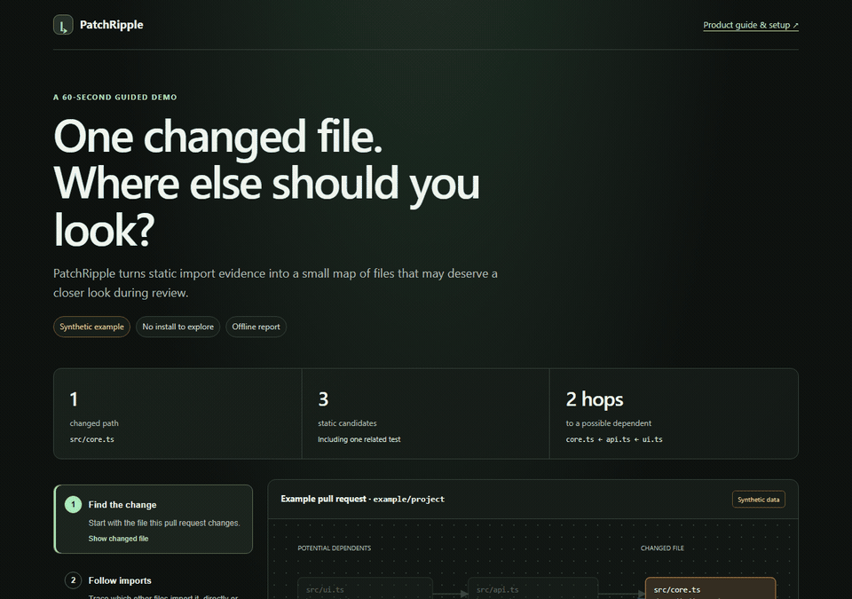

# PatchRipple

**Static impact maps for pull requests.**

PatchRipple reads exact Git revisions and maps changed files to potential import dependents, related-test evidence, and base-revision CODEOWNERS. It creates a self-contained report you can inspect offline.

> Static candidates are possibilities—not runtime effects, test coverage, or proof that a change is safe. Review the evidence and warnings alongside the diff.

[Open the demo walkthrough](docs/demo/walkthrough.html) · [See the security model](docs/SECURITY.md) · [Review the graph schema](docs/graph-schema-v1.md)

## What it does

- Compares a pull request from the merge base of its base and head revisions, or compares two exact revisions directly.
- Finds static JavaScript, TypeScript, and Python import relationships in both revisions.
- Adds related-test hints and uses CODEOWNERS from the base revision.
- Produces an offline HTML report, JSON graph, SVG map, and metadata file.
- Shows uncertainty, warnings, and analysis limits instead of presenting guesses as proof.

The analyzer and Action read repository data and create the report in the environment where you run them. The explicit `fetch-pr` command retrieves only a public GitHub base branch and PR head into PatchRipple-owned refs. These commands do not execute code, configuration, or hooks from the repository being analyzed, and they do not install its dependencies.

## Try the demo

The animated preview above and the [clickable walkthrough](docs/demo/walkthrough.html) use fictional repository data and commit SHAs. Open the walkthrough or [offline report](docs/demo/index.html) in a browser; neither requires installation.

## Quick start

Use Node.js 24 or newer and npm. This snapshot has no versioned GitHub release or tag, and the public npm registry has no `patchripple` package. To install the verified open PR #7 candidate from an immutable source archive, without cloning Git:

~~~sh
npm install --global --ignore-scripts --no-audit --no-fund "https://github.com/icecold009/PatchRipple/archive/a6be403338c28e27b081a8839f6f85ac6836ac89.tar.gz"
patchripple --version
~~~

The pinned code-bearing commit passed local lint, typecheck, all 59 tests, build, package smoke, generated-file consistency, and hosted [Trusted CI #70](https://github.com/icecold009/PatchRipple/actions/runs/38427654921) and [Static PR impact #26](https://github.com/icecold009/PatchRipple/actions/runs/38427655088). CI #70 includes generated browser fixtures and Chromium, Firefox, and WebKit checks. PR #7 remains an open draft; this candidate is not merged or a versioned release. The merged `main` pin is `4b45616e941ebe349b845a62a8941c586fbb18c5`. Review [release evidence](docs/RELEASE_EVIDENCE.md) before choosing a source revision.

For a public GitHub PR whose exact commits are missing from the target clone, fetch the base branch and PR head into PatchRipple-owned refs:

~~~sh
patchripple fetch-pr --repo /path/to/target --repository OWNER/REPOSITORY --base-branch main --pr 123
~~~

Replace the repository, base branch, and PR number with the public PR's values. The command uses HTTPS, rejects local Git URL rewrites, disables credential helpers, hooks, tags, and recursive submodules, and atomically updates only `refs/patchripple/manual/base` and `refs/patchripple/manual/head`. It downloads Git objects but leaves the checked-out branch and working tree untouched. It does not support private repositories.

First check that the revisions and output path are usable:

~~~sh
patchripple doctor --repo /path/to/target --base refs/patchripple/manual/base --head refs/patchripple/manual/head --out /path/to/new-report
~~~

Then generate the report in that same new path:

~~~sh
patchripple analyze --repo /path/to/target --base refs/patchripple/manual/base --head refs/patchripple/manual/head --repository https://github.com/OWNER/REPOSITORY --out /path/to/new-report
~~~

`doctor` creates no files, so its output path can be reused by `analyze`. The output directory must be new and outside the target repository; existing paths are refused. In a shallow clone, deepen or unshallow the requested history if `doctor` cannot find the merge base. `doctor` itself remains read-only; `fetch-pr` writes the two namespaced refs and fetched objects.

PR mode is the default: it compares `merge-base(base, head)` to `head`. Use `--mode direct` to compare exactly the two supplied revisions.

## Read the report

The output bundle contains:

| File | Contents |
| --- | --- |
| `index.html` | Interactive, self-contained offline report |
| `graph.json` | Validated graph data |
| `graph.svg` | Static map |
| `metadata.json` | Tool version, generation time, and analysis limits |

The HTML report loads no external assets or data. Its source and comparison links open GitHub only when you choose them. The diagram shows a focused neighborhood; the full candidate list and analysis warnings remain available in the report.

An exit code of `0` means a valid report was produced, possibly with visible uncertainty. It does not mean the analysis is complete or the change is safe.

## Supported analysis and limits

| Area | Evidence PatchRipple can report |
| --- | --- |
| JavaScript and TypeScript | Literal imports and re-exports, type-only imports, literal dynamic imports, and `require`; relative paths, supported nested TypeScript path aliases, and declared npm/Yarn/pnpm workspace package entries |
| Python | Static `import` and `from` relationships, relative imports, package initializers, and configured source roots |
| Tests | Likely related test files based on import relationships and adjacent or naming conventions; these are heuristics, not test-coverage results |
| CODEOWNERS | Matches from base-revision precedence (.github/CODEOWNERS, root CODEOWNERS, then docs/CODEOWNERS); the last matching supported rule wins |

Dynamic import expressions, wildcard or unresolved Python imports, unresolved local paths, unsupported configuration or syntax, parser uncertainty, symlinks, submodules, and resource limits can produce warnings or omissions. Expected external package imports remain visible as exclusions; by themselves, they do not make the graph incomplete.

Workspace discovery reads `package.json` `workspaces` arrays or `{ "packages": [...] }` objects. It also reads a top-level `packages:` list of simple strings from `pnpm-workspace.yaml`, including quoted include and `!` exclude patterns. Workspace globs support `*`, `**`, `?`, and multiple flat brace groups with 2–16 nonempty alternatives per group, up to 256 expansions per workspace declaration. Complex YAML, inline lists, character classes, nested or malformed brace groups, groups with more than 16 alternatives, declarations exceeding the expansion cap, and conflicting declarations are reported as unsupported. TypeScript alias inheritance follows relative config files included in the analyzed Git snapshot. Package-based or external `tsconfig` extends and project-reference build semantics are not executed or inferred; non-empty project references produce an explicit incomplete-analysis warning.

Supported CODEOWNERS patterns include directory patterns, `*`, `**`, and `?`, with user, team, or email owners. Unsupported patterns warn; team membership is not looked up.

A “complete” graph means complete within PatchRipple’s documented static syntax. It does not establish runtime reachability, test coverage, or safety. See the [graph schema](docs/graph-schema-v1.md) for warning categories and completeness semantics.

Per-revision input limits:

| Limit | Maximum |
| --- | ---: |
| Files | 5,000 |
| Aggregate source size | 40 MiB |
| Source file size | 512 KiB |

Graph and analysis limits:

| Limit | Maximum |
| --- | ---: |
| Candidate nodes | 500 |
| Candidate edges | 2,000 |
| Reverse traversal depth | 20 |
| Git and parsing time | 60 seconds |

CLI and Action options can lower the file-count, candidate-node, traversal-depth, and analysis-time ceilings; supplied values cannot raise a built-in maximum. The report diagram displays up to 18 nodes at a time; filters and hop controls help inspect larger candidate sets.

## GitHub Action

The repository includes an Action manifest and a [consumer workflow template](docs/consumer-workflow.yml.example). The template uses `pull_request` with read-only `contents` permission and verifies that the exact base and head Git objects are available.

Before using the template, replace `PATCHRIPPLE_COMMIT` with the full commit SHA you have reviewed. Keep the exact-revision checks and read-only permissions. Do not use `pull_request_target` or expose secrets to analysis of pull-request data.

The generated bundle can include repository paths, owners, and dependency relationships. Review it before uploading or sharing it. See the [security notes](docs/SECURITY.md) for the full trust boundary.

## Develop PatchRipple

Use Node.js 24 or newer and Git in a trusted PatchRipple checkout:

~~~sh
npm ci --ignore-scripts
npm run verify
npm run demo
npm run test:package
~~~

`npm run verify` runs linting, type checking, tests, and the build. Browser checks are also available:

~~~sh
npm run test:browser:fixtures
npm run test:browser
~~~

Browser tests require the supported Playwright browser to be installed. These commands build and test PatchRipple itself; they do not install or execute dependencies from a target repository.

## License

PatchRipple is MIT licensed. Third-party component notices and license details are included in [`dist/THIRD_PARTY_NOTICES.txt`](dist/THIRD_PARTY_NOTICES.txt).
